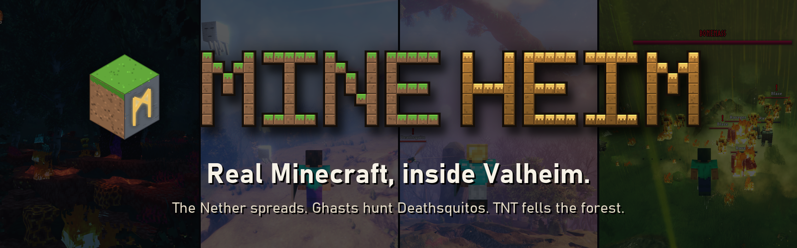
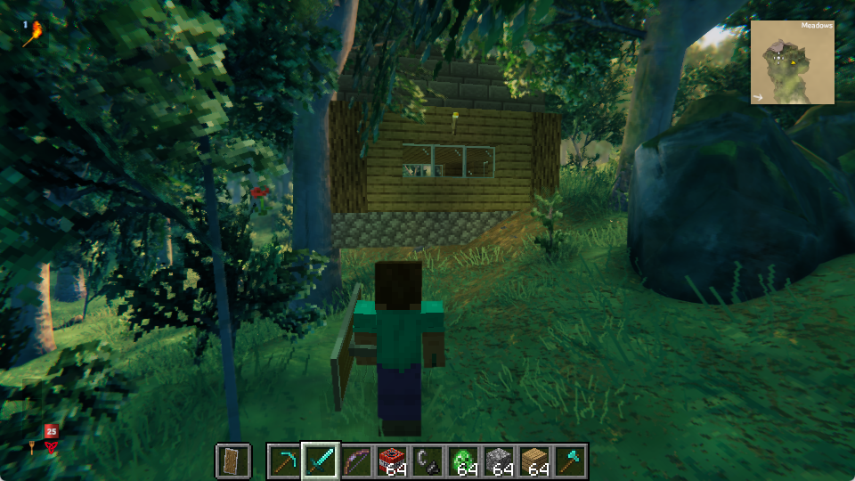
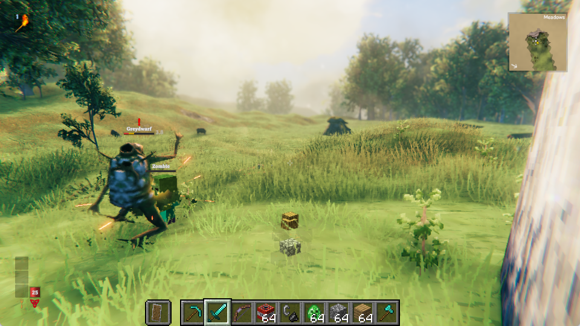
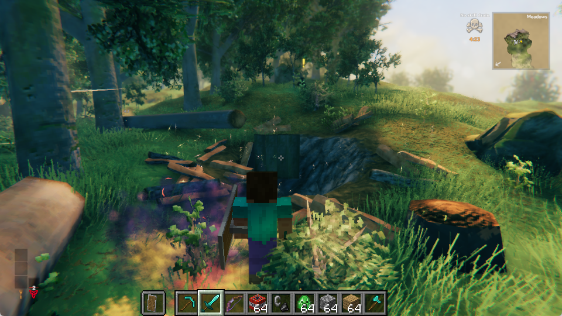
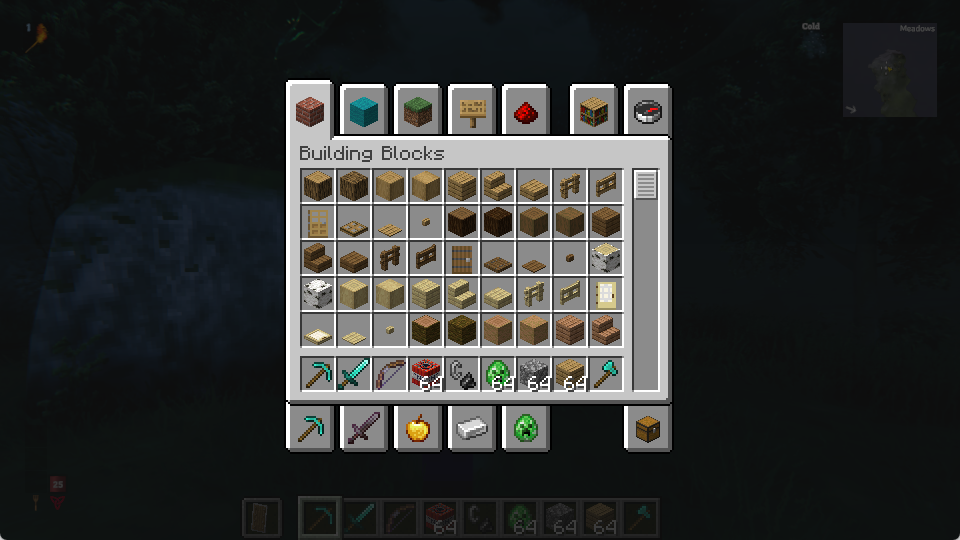

<p align="center"></p>

**MineHeim puts real Minecraft inside Valheim.** Not a texture pack and not a remake: the actual Minecraft Java game runs
next to Valheim, and its picture is drawn into Valheim's world, depth-correct. Steve stands where your Viking stands, his blocks
sit on Valheim's ground behind its trees, his TNT blows craters into it, and Minecraft's zombies pick fights with Valheim's Greydwarfs.

> Video: _link coming soon_ · Download: [latest release](../../releases/latest) · Windows 10/11 · Valheim (Steam) + Minecraft Java 26.3

<table>
<tr>
<td width="50%"><br><b>Build in Valheim.</b> Minecraft blocks stand on Valheim's terrain, and Valheim's trees, grass and rocks are drawn in front of them where they are nearer.</td>
<td width="50%"><br><b>Two bestiaries, one fight.</b> Minecraft's monsters hunt Valheim's creatures and Valheim's creatures fight back, with damage converted between the games.</td>
</tr>
<tr>
<td><br><b>TNT means it.</b> Minecraft explosions hurt creatures, wreck Valheim buildings, fell trees, crack rocks and dig craters, through Valheim's own damage rules.</td>
<td><br><b>Minecraft's own screens.</b> Its inventory, creative tabs, chat and commands open right over Valheim and work with your mouse and keyboard.</td>
</tr>
</table>

## What you can do

- **Play Steve in Valheim.** Valheim's camera drives Minecraft's; Steve walks, jumps and swims with your Viking (whose body is hidden).
  Valheim draws him itself, in the same frame, so he never trails behind when you run or turn; classic Steve, your own Minecraft skin or any skin file.
- **Build, mine and blow things up.** Place and break Minecraft blocks on Valheim's ground; your Viking and Valheim's creatures bump into them.
  A Minecraft pickaxe digs Valheim's terrain like a Valheim pickaxe, an axe fells its trees.
- **Fight with Minecraft weapons.** Swords, bows (Power and Infinity included), TNT, creeper eggs and ender pearls work on Valheim's creatures,
  at their real Minecraft damage, converted to Valheim's scale.
- **A shield that means it.** Raise Minecraft's shield and Valheim's attacks from the front are stopped dead; the attacker staggers and takes half back.
- **Minecraft mobs vs Valheim creatures.** Zombies, skeletons and creepers hunt Greydwarfs, Trolls and deer; Valheim's creatures attack Minecraft's mobs;
  your Viking can hit Minecraft's mobs with Valheim weapons.
- **Valheim's buildings are solid in Minecraft.** Walls, floors, roofs and doors of Valheim builds become invisible Minecraft collision:
  mobs and items stop at walls, walk under roofs and through open doors.
- **Items cross between the worlds.** Throw a Valheim item and it lands in Minecraft as its twin (Wood becomes oak logs, Stone cobblestone,
  Iron iron ingots...); throw a Minecraft item and it lands in Valheim. Moved, never copied. About 45 pairs, and you can add your own.
- **One light.** Minecraft's sun follows Valheim's day and night; Valheim's fires light Minecraft's blocks; Minecraft's torches and lava light Valheim.
- **The Nether comes to Valheim.** Light a Nether portal and the land around it turns to Nether: a crust of netherrack, nylium and soul soil
  over Valheim's ground, fire and fungi, the Ashlands' ash and sky, and Nether mobs (piglins, hoglins, blazes, ghasts...). Break the portal
  and it heals; wards keep it out. The air shimmers with heat, the Nether's drone plays, animals flee and creatures burn.
  Nobody travels: the Nether comes here.
- **And the End.** Fill an End portal and the land fades into the End: end stone, chorus, obsidian spikes with end crystals,
  endermen and shulkers, the Mistlands' mist, and in the end the Ender Dragon circling its portal. Kill it and the land heals.
- **Creative or Survival.** F8 switches. Creative gives Steve a builder's kit and flight (double-tap Jump); Survival plays by Minecraft's rules.
  Either way the Viking's health is the one that counts, and Minecraft's hearts show it.

## Install

You need Windows 10/11, **Valheim** on Steam and **Minecraft Java Edition** on your own Microsoft account.

1. Download `MineHeim-<version>.zip` from [Releases](../../releases/latest), unzip it anywhere, close Valheim.
2. Double-click **`Install.cmd`**. It finds Valheim, installs BepInEx and ReShade into it (official downloads, hash-checked), and sets up
   Prism Launcher with a ready "MineHeim" Minecraft instance.
3. Prism Launcher opens once: sign in with the Microsoft account that owns Minecraft, then close it.

Then just start Valheim. Minecraft starts by itself in the background and joins in. In a world, press **F7** to become Steve.
Step-by-step with screenshots: [docs/INSTALL.md](docs/INSTALL.md). To remove it, double-click `Uninstall.cmd`.

## Controls

| key | what it does |
|---|---|
| **F7** | Minecraft mode: you are Steve. The mouse buttons break, place and hit (anything in hand hits Valheim's creatures), the wheel and 1-9 pick Minecraft's hotbar, **Q** throws (Ctrl+Q the stack), **Tab** opens Minecraft's inventory, **T** its chat, **/** a command. F7 again: you are the Viking, with everything Valheim's (Minecraft's blocks, mobs and items stay). |
| **F8** | Steve: Creative <-> Survival |
| **F10** | MineHeim's status, top left: Minecraft attached, frame rate and delay, who draws Steve, the portals near you. If Minecraft is not running (it crashed, or you closed it), it starts it again. |
| **F11** | who draws Steve: Valheim (never trails behind) or Minecraft (with his held item and armour) |
| **Alt + wheel** (Minecraft mode) | zoom Valheim's camera (the wheel alone picks Minecraft's hotbar) |
| **Jump, Jump** (double-tap, as Steve) | Creative: fly or land. Hold Jump to rise, Left Ctrl to sink, Run to go faster. |
| **Right mouse, held** (Minecraft mode) | raise Minecraft's shield |
| **drop an item** (Valheim inventory) | items with a Minecraft twin cross into Minecraft |
| **E** on a Minecraft chest, crafting table or furnace | opens it, as the Viking too |
| everything else | Valheim's own: walking, E, the camera, menus |

All settings live in `Valheim\BepInEx\config\dev.daolyap.mineheim.cfg`; see [docs/CONFIGURATION.md](docs/CONFIGURATION.md).

## How it works

Two unmodified games, one small mod in each, talking over `127.0.0.1`. Valheim's camera, terrain and buildings go to Minecraft every frame;
Minecraft renders its world from Valheim's point of view into colour + depth buffers in shared memory; a ReShade add-on inside Valheim
re-projects that picture to Valheim's newest camera pose and depth-tests it against Valheim's own depth, so each pixel shows whichever game
is nearer. Events (explosions, swings, arrows, mobs, items) cross both ways as JSON messages.

The full technical breakdown, with diagrams: [docs/HOW-IT-WORKS.md](docs/HOW-IT-WORKS.md). What broke along the way: [docs/ENGINEERING-NOTES.md](docs/ENGINEERING-NOTES.md).

## Fair play and safety

- **Single-player only** (or your own private world). Never take it onto a public server.
- It never gets around Minecraft's ownership check: Minecraft runs on your own account through Prism Launcher (or your own launcher profile).
- The link listens on `127.0.0.1` only, without a password: close Minecraft when you are done.
- Back up your Valheim saves first (`%USERPROFILE%\AppData\LocalLow\IronGate\Valheim`). MineHeim never writes into them, but you play with mods.

## Known limits

- Windows only. Valheim must run in Direct3D 11 (its default).
- Two games at once is heavy: a desktop with a dedicated GPU and 16 GB of RAM is the comfortable floor.
- Creatures and mobs in the other world are invisible stand-ins updated 5-10 times a second, so a fast one can be a little behind.
- Built for Valheim 1.0.17 and Minecraft 26.3 with Fabric Loader 0.19.5; a game update can break it until MineHeim is updated.

## Building from source

From a clone, the installer builds whatever is not built yet and then installs it:

```powershell
.\Install-MineHeim.ps1                        # first time: builds all three parts, installs everything
.\Install-MineHeim.ps1 -Build -Only Valheim    # after changing the plugin: rebuild + reinstall just that
.\Install-MineHeim.ps1 -Build -Only Minecraft  # after changing the Fabric mod: rebuild + update Prism's instance
.\tools\build.ps1 -Test                       # build only (plus the unit tests), install nothing
.\tools\make_release.ps1                      # build everything, packaged as dist\MineHeim-<version>.zip
```

`-Only` takes `Valheim` (BepInEx + plugin), `Compositor` (ReShade + add-on) and `Minecraft`, in any combination. What the build
needs, each found automatically (it tells you the install command if one is missing):

| Part | Needs | Notes |
|---|---|---|
| Valheim plugin | .NET SDK 8 or newer | compiles against your own Valheim install, found in any Steam library |
| Minecraft mod | JDK 25 (`winget install EclipseAdoptium.Temurin.25.JDK`) | Gradle downloads itself |
| Compositor | MSVC: Visual Studio / Build Tools with C++, or `python tools\get_msvc.py` (portable, no admin) | rarely changes |

The real-game test scripts (`host\v040_test.ps1`, `host\v090_test.ps1`, ...) drive both games through plugin test hooks; see
[docs/HOW-IT-WORKS.md](docs/HOW-IT-WORKS.md#testing).

## Credits

Made by **Daolyap**, **built with AI**: Claude Code (Anthropic) wrote and tested the code under the author's direction and rules.
The passthrough idea and the Minecraft-side starting point come from [rehan-remade/universal-modder](https://github.com/rehan-remade/universal-modder) (MIT).
It stands on [BepInEx](https://github.com/BepInEx/BepInEx) + HarmonyX, [ReShade](https://reshade.me) (crosire), [Fabric](https://fabricmc.net)
and [Prism Launcher](https://prismlauncher.org); see [THIRD-PARTY.md](THIRD-PARTY.md).

Minecraft is a trademark of Mojang Studios / Microsoft; Valheim of Iron Gate AB. MineHeim is a fan project, not affiliated with either.
It contains no file, asset or decompiled code of either game and needs your own copies of both. MIT licensed: see [LICENSE](LICENSE).
