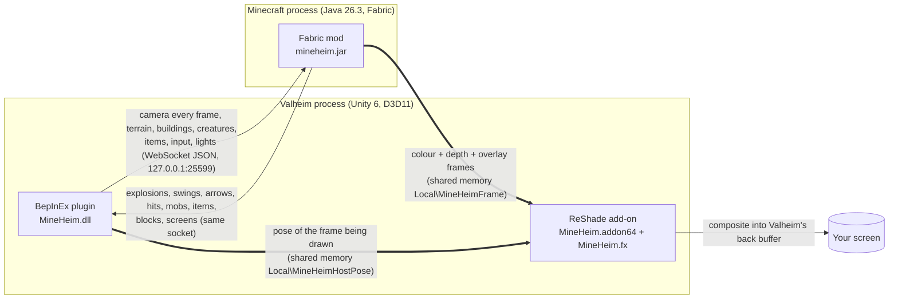
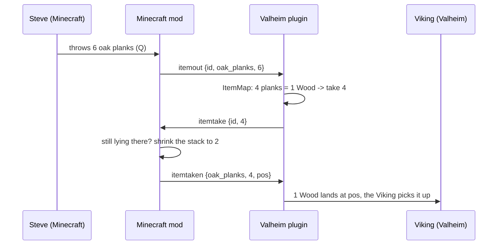

# How MineHeim works

MineHeim runs two unmodified games at once and makes them share one world. Valheim is the **host**: its camera, its terrain, its
health and its saves are the truth. Minecraft is the **guest**: it renders its own world from Valheim's point of view and hands the
picture back, and the two exchange events in both directions.



## 1. One camera

Every frame, in `Camera.onPreRender`, the plugin reads the pose Valheim is about to render with (camera shake included) and sends it as a
`cam` message: position, yaw/pitch/roll, vertical field of view, first/third person, the player's feet. Minecraft's camera follows it
exactly; Steve is placed on the Viking's feet.

The worlds are mapped with a fixed, axis-swapping transform:

```
Minecraft (x, y, z) = Valheim (x, y + 70, -z)
```

Valheim is left-handed with z pointing north, Minecraft right-handed with z pointing south, hence the sign flip. The fixed `+70` puts
Valheim's sea level (y 30) at Minecraft y 100. It is never re-levelled per session, because Minecraft's world persists: what you built
stays attached to the same Valheim terrain every time. The maths is checked against Minecraft's own camera code on 50,000 random
orientations (worst error 4.8e-15), and in the real games a Minecraft pillar lands within about 1 pixel of where Unity projects it.

## 2. One picture

Minecraft renders its world into three layers, published in a ring of slots in shared memory: **colour**, **depth** and an **overlay**
(hand, HUD, open screens like the inventory). Inside Valheim's process a ReShade add-on uploads the newest Minecraft frame to the GPU and
an effect composites it:

1. **Re-projection.** Minecraft's frame is 1-3 frames older than Valheim's. The plugin drops a marker into the main camera's command
   stream (`CommandBuffer.IssuePluginEvent`) so the add-on knows exactly which Valheim pose is being drawn; the shader ray-marches each
   pixel of Minecraft's depth buffer from the pose it was rendered with to the current one. Measured while strafing: edge error 1.2 px
   mean with re-projection, 5.6 px without.
2. **Depth test.** Each pixel shows whichever world is nearer, using Valheim's own depth buffer (reversed-Z, upside down in D3D11). That
   is why Valheim's grass grows over the base of a Minecraft wall and a tree trunk hides half a cottage.
3. **Relighting.** Minecraft's colours are tinted with Valheim's scene light and haze so the blocks sit in the same weather.
4. **Overlay** on top: Minecraft's hand, hotbar and any open screen.

## 3. One ground, both ways

**Valheim to Minecraft.** Minecraft's world is a void. The plugin probes Valheim's terrain with downward raycasts (160 columns a frame
around the player) and sends each column's height; Minecraft fills the two cells just under the surface with **barrier blocks**
(invisible, solid), so Minecraft blocks, items and mobs rest on Valheim's ground. A block placed on it sits up to 1 m into the ground,
never floating above it.

**Valheim's buildings** are voxelized whole: every building piece within 32 m is tested cell by cell against its own colliders
(`Physics.OverlapBox`), and the cells become barriers too. A door that swings changes the piece's collider signature and is voxelized
again, so it opens a passage. Ground and buildings share **reference-counted cells**: a floor resting on the ground never clears the
ground's barrier when it goes.

**Minecraft to Valheim.** Every solid Minecraft block near the player becomes a 1 m box collider in Valheim, so the Viking and Valheim's
creatures bump into what you build, and walk through what you break.

## 4. One fight

Damage always goes through each game's own damage code, so armour, resistances, blocking and creature AI apply.

- **Steve's weapons** reach Valheim's creatures from the host side: a sword swing hits the creatures in front of the Viking, arrows in
  flight are traced through Valheim's world each tick, explosions are area hits that also damage buildings, fell trees, crack rocks and
  dig craters with the Valheim pickaxe's own terrain operation (which respects wards and no-build areas).
- **Valheim creatures in Minecraft:** each creature near the player stands in Minecraft as an invisible `mineheim:creature` entity of its
  size (no AI, not saved, not pickable on the client). Idle Minecraft monsters target the nearest one they can see; their hits are sent
  back and applied to the real creature.
- **Minecraft mobs in Valheim:** each mob gets an invisible body in Valheim, cloned from a creature prefab with its looks, AI, drops and
  sounds removed and its capsule resized. Valheim's creatures see it as an enemy (faction `PlayerSpawned`) and attack it; the Viking can
  hit it with Valheim weapons. A hit on a body is caught before Valheim applies it and sent to Minecraft, where the mob takes it as a hit
  from the attacker's stand-in, and fights back.
- **One exchange rate.** A Minecraft health point is worth the Viking's max health / 20 in Valheim. So a zombie's 3 takes 15% of the
  Viking whatever his health, Steve's diamond sword (7) deals 35 to a creature when the Viking has 100 health, and a Troll's 70 is 14 to a
  zombie. Steve's real damage is reported (attack-damage attribute x attack charge for swings, ceil(speed x base damage) for arrows).
- **Valheim owns Steve's health.** Minecraft never damages its player; a mob's hit becomes Valheim damage to the Viking, which Valheim's
  armour and blocking (and the Minecraft shield, which blocks like a perfect parry) can stop. In Survival Minecraft's hearts and hunger
  bar show the Viking's.

## 5. Items that move, never copy



Only after Minecraft has taken the items away does Valheim create them, so an item picked up again in between never crosses and nothing
is ever doubled. The other way, a Valheim item the Viking drops is destroyed and sent as `itemin`, landing in Minecraft tossed the same
way. Creative's items are free, so by default they do not cross into Valheim.

## 6. One light

- Minecraft's clock follows Valheim's day fraction (`time set` every 2 s when it moved), so Minecraft's sky light and therefore its blocks
  dim at dusk and go dark at night together with Valheim's scene.
- Burning Valheim fires, hearths and torches become invisible Minecraft `light` blocks.
- Light-emitting Minecraft blocks (torches, lanterns, glowstone, lava, fire) become Unity point lights in Valheim; only the nearest
  dozen are switched on, because each costs frame time.

## 7. Minecraft's own screens

Minecraft draws its screens (inventory, creative tabs, chat, chests) into the overlay layer anyway. When one opens, Minecraft reports it;
Valheim frees the cursor, stops its own input and forwards the cursor position, buttons, wheel, keys and typed text. Minecraft 26 uses
SDL3, so keys travel as USB scancodes and modifiers as SDL bit masks; clicks go straight to the open screen at the forwarded position.
Minecraft's window is kept behind Valheim and out of the taskbar (not hidden or minimised: then it stops rendering).

## 8. Starting and stopping

When Valheim starts and no Minecraft answers within a few seconds, the plugin runs Prism Launcher with `--launch MineHeim`. While attached,
Minecraft's window stays out of the way; when Valheim closes, the plugin sends `quit` and Minecraft saves its world and exits.

## Testing

Everything was built against oracles, not eyeballing:

- `valheim/Core.Tests`: the coordinate maths, every message format, the barrier reference counting and the item map (no game needed).
- `host/pose_oracle.py`, `host/composite_oracle.py`: pixel alignment and re-projection error in the real games (the shader stamps frame
  numbers as a barcode into the picture so screenshots can be paired with poses exactly).
- `host/collision_test.ps1`, `input_test.ps1`, `events_test.ps1`, `v020_test.ps1`, `v040_test.ps1`, `v090_test.ps1`: scripted runs of
  both real games through plugin test hooks (`BepInEx/mineheim-cmd.txt`) and `um win drive`. The 0.9.0 release passed the 0.4.0 suite
  19/19 and the 0.9.0 suite 6/6 on the development PC.

The gotchas found along the way are in [ENGINEERING-NOTES.md](ENGINEERING-NOTES.md).
