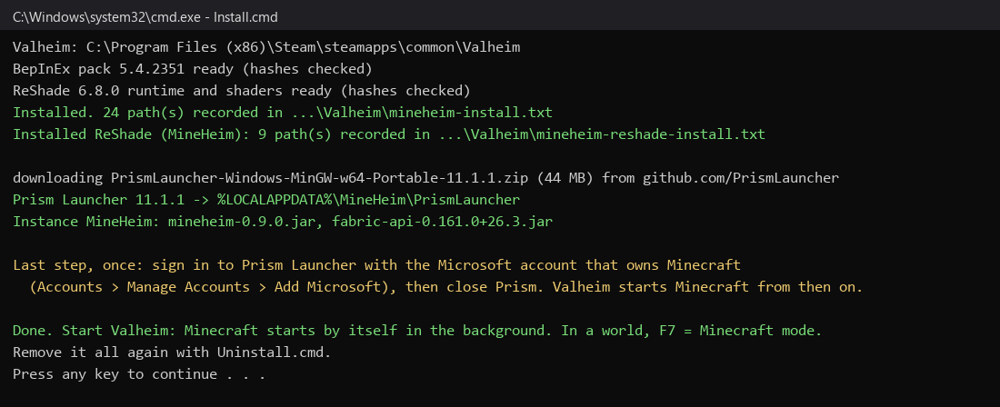
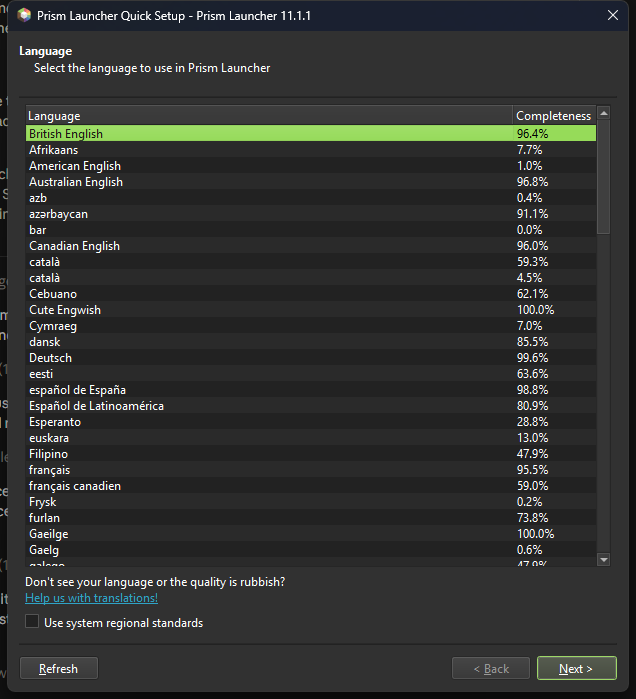

# Installing MineHeim

About ten minutes, most of it downloads. You need:

- **Windows 10 or 11**
- **Valheim** on Steam
- **Minecraft Java Edition**, owned by your Microsoft account (MineHeim never gets around the ownership check)
- A reasonably strong PC: two games run at once. A dedicated GPU and 16 GB of RAM is the comfortable floor.

Back up your Valheim saves first: copy `%USERPROFILE%\AppData\LocalLow\IronGate\Valheim` somewhere safe. MineHeim does not write
into them, but you are playing with mods.

## 1. Download

Get `MineHeim-<version>.zip` from the [latest release](../../../releases/latest) and unzip it anywhere (your Downloads folder is fine).
**Close Valheim.**

## 2. Run the installer

Double-click **`Install.cmd`**. It:

1. finds Valheim through your Steam libraries;
2. downloads **BepInEx** (the Valheim mod loader, from Thunderstore) and **ReShade** (the picture compositor, from reshade.me), checks their
   SHA-256 hashes, and installs them with the MineHeim plugin into Valheim's folder;
3. downloads **Prism Launcher** (an open-source Minecraft launcher, from its GitHub), checks its hash, and creates a ready
   **MineHeim** instance: Minecraft 26.3 + Fabric + the MineHeim mod + Fabric API.

Every file it adds to the Valheim folder is listed in `mineheim-install.txt` and `mineheim-reshade-install.txt`, so `Uninstall.cmd`
removes exactly those. If Valheim already has another BepInEx or ReShade that MineHeim did not install, the installer stops rather than
overwrite it. Valheim in a different Steam library? `Install.cmd -ValheimDir "D:\SteamLibrary\steamapps\common\Valheim"`.

## 3. Sign in to Minecraft, once

Prism Launcher opens at the end. Click through its quick setup (language, then **Add Microsoft account**) and sign in with the
account that owns Minecraft. Then close Prism.

That is the only time you see Prism. From now on Valheim starts it for you.

## 4. Play

Start Valheim from Steam as usual. A few seconds after the main menu, Minecraft starts by itself in the background (the first start
downloads Minecraft and Fabric and takes a minute or two). Load a world: Steve appears where your Viking stands.

- **F7** makes you Steve: left click breaks and hits, right click places, 1-9 and the wheel pick Minecraft's hotbar,
  **Tab** opens Minecraft's inventory (creative tabs in Creative), **T** its chat. F7 again and you are the Viking, with Valheim's
  own controls; what you built stays. As Steve in Creative, nothing hurts you.
- **F8** switches Steve between Creative and Survival.

When you close Valheim, Minecraft saves and closes too.

## Troubleshooting

| what you see | what to do |
|---|---|
| No Steve, no Minecraft blocks | Is Minecraft running (Task Manager, `javaw.exe`)? If not, start Prism and launch the MineHeim instance yourself once to see its error. |
| Minecraft runs but nothing shows in Valheim | Valheim must use Direct3D 11. In Steam: Valheim > Properties > Launch options: `-force-d3d11`. |
| The installer says BepInEx or `dxgi.dll` "was not installed by this script" | Another mod loader or ReShade is in the Valheim folder. Remove it (or install MineHeim into a clean copy of Valheim). |
| Steam says Valheim's files are modified / Valheim updated and MineHeim stopped working | Run `Install.cmd` again after the update; check the releases page for a MineHeim update. |
| Very low frame rate | Two games at once: lower Valheim's graphics settings; close other programs. Minecraft renders at Valheim's window size. |
| You already use your own launcher | Make a Fabric 0.19.5 profile for Minecraft 26.3 with its own game directory, put the two jars from the zip's `minecraft\` folder into its `mods` folder, and set `Minecraft.LaunchCommand` (see [CONFIGURATION.md](CONFIGURATION.md)) or start it yourself before Valheim. `Install.cmd -NoMinecraft` skips Prism. |

The logs to look at (and to attach to a bug report): `Valheim\BepInEx\LogOutput.log` and Prism's instance log
(`%LOCALAPPDATA%\MineHeim\PrismLauncher\instances\MineHeim\.minecraft\logs\latest.log`).

## Removing it

Double-click **`Uninstall.cmd`**. It removes exactly what the installer added to the Valheim folder and asks whether to remove
MineHeim's Minecraft too (Prism Launcher, the MineHeim instance and its world). Your Valheim saves are never touched.
